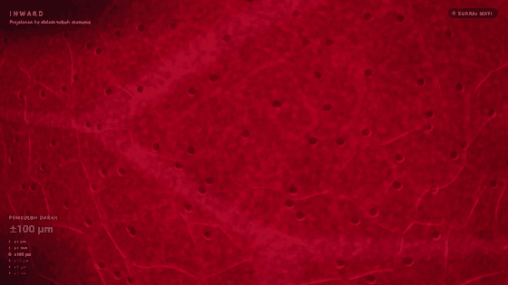
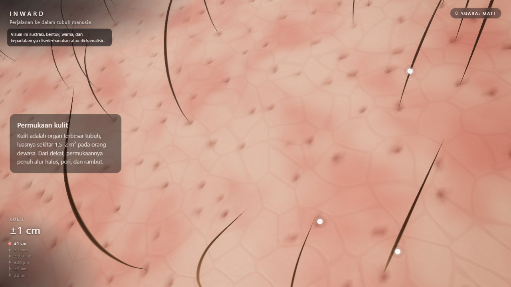
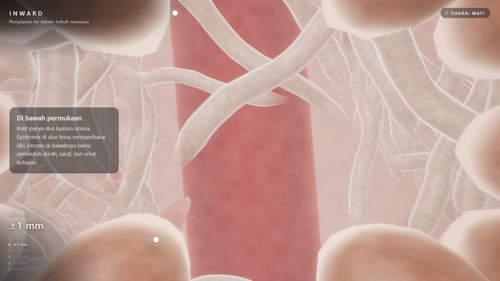
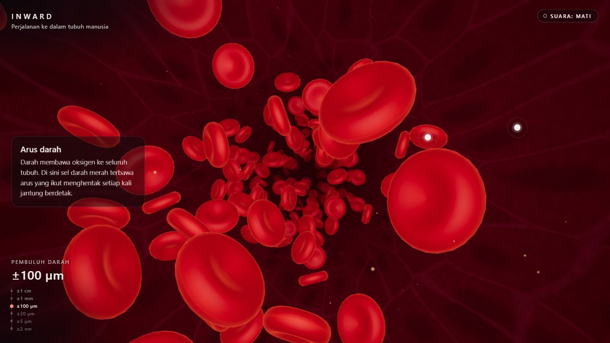
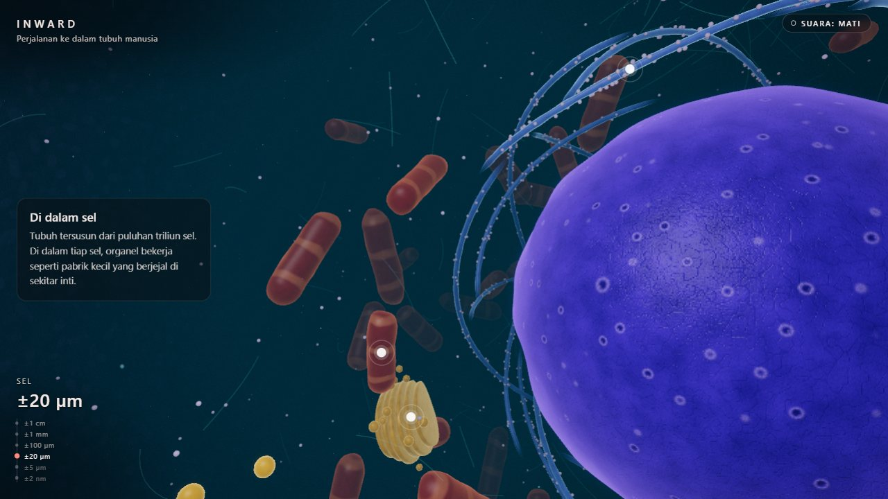
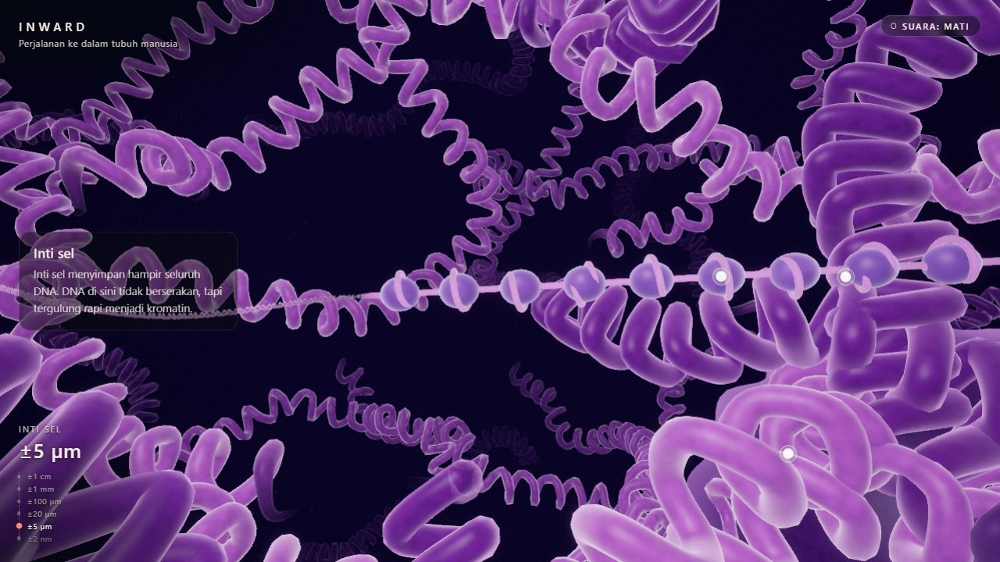
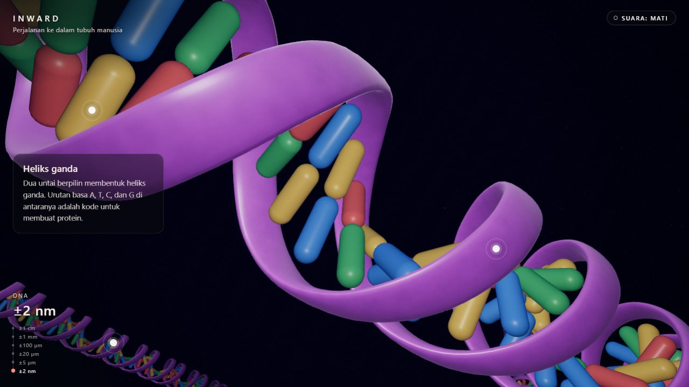

# Inward

A 3D scroll journey into the human body. Starting on the surface of the skin, the camera sinks through the dermis, rides the bloodstream with the red blood cells, pushes through a cell membrane, enters the nucleus and ends at the DNA double helix, with no visible scene cuts. At the end, the camera rushes back out to the skin.

**Live demo:** https://inward-orcin.vercel.app



> **Note:** the visuals are an illustration. Shapes, colours, relative sizes and densities are simplified or dramatised so they read on screen. The texts and facts are based on scientific references; the full list, with a marker for each fact that still needs checking against a source, is in [docs/teks-dan-fakta.md](docs/teks-dan-fakta.md). The site itself is in Indonesian.

## The journey

| Skin, ±1 cm | Dermis, ±1 mm |
| --- | --- |
|  |  |
| **Blood vessel, ±100 µm** | **Cell, ±20 µm** |
|  |  |
| **Nucleus, ±5 µm** | **DNA, ±2 nm** |
|  |  |

Every scene has a short text that fades in and out with the scroll, 2–3 click points with a fact each (mouse, keyboard and touch), a scale indicator running from centimetres down to nanometres, and an optional procedural soundscape. The closing shows that the DNA in a single cell is about 2 metres long when stretched out, then zooms back out to the skin.

## Tech stack

- **Three.js** and **GLSL**: every object is generated in code. No external models or textures.
- **GSAP ScrollTrigger** and **Lenis**: smooth scrolling, mapped onto one journey timeline.
- **Web Audio API**: the heartbeat, flow and drones are synthesised in the browser.
- **Vite** (Rolldown) for the build, **Vitest** for tests, **Vercel** for hosting.

## Running it

Requires Node.js 20 or newer.

```bash
npm install
npm run dev       # development server
npm run build     # production build into dist/
npm run preview   # serve dist/ locally
npm test          # unit tests
npm run facts     # regenerate docs/teks-dan-fakta.md from src/content/story.js
```

Useful URL parameters:

- `?debug`: debug panel (fps, live scenes, draw calls, triangles, quality preset, snapshots).
- `?quality=mobile` or `?quality=desktop`: force a quality preset (normally picked automatically).
- `?scale=fixed`: turn off dynamic resolution, for performance comparisons.

### Deploying

It is a static site. `vercel.json` sets the build (`npm run build` into `dist/`) and long-lived cache headers for the hashed assets. Set `VITE_SITE_URL` (see `.env`) to the site's origin, without a trailing slash, so the Open Graph and Twitter Card image URLs are absolute.

## Project structure

```
src/
  content/story.js   all text: scene names, scales, captions, facts with check markers, closing, fallback
  core/              timeline, scene manager, transitions, post-processing, quality presets, dynamic resolution
  scenes/            one folder per scene, each with its own coordinates and shaders
  shaders/           shared GLSL (noise, bump mapping, nuclear envelope)
  ui/                captions, click points, scale indicator, sound toggle, fallback
  audio/             procedural soundscape
tests/               unit tests (timeline, geometry, choreography, rewind, culling, …)
scripts/             export of all texts and facts
```

## Technical challenges

- **Seven orders of magnitude.** From centimetres to nanometres in one world would wreck floating-point precision on the GPU, so every scene has its own coordinates and camera. Each hand-over is covered by the surface being pierced: the camera presses into it and a membrane-like hole opens onto the next scene.
- **Only what is needed stays alive.** Only the active scene and its neighbours hold GPU memory. Distant scenes are released with their geometry, materials, shaders and textures, and neighbours are built while the browser is idle. The closing rewind stays within that budget: it zooms out through full-resolution images of the middle scenes captured on the way in, so only DNA and the skin are real 3D scenes while it plays.
- **Lots of objects.** Thousands of red blood cells, skin cells, ribosomes and base pairs are instanced. Anything outside the view or lost in the haze is skipped, and distant objects use lighter models. Long tubes (chromatin, the DNA ribbon) are cut into chunks so they can be culled, then merged per region to keep draw calls low.
- **Pixel cost.** During a transition two scenes are drawn at once. The render resolution drops while the frame rate is low: down to 1× CSS pixels, below that only when frames are really slow, and back up once they recover.
- **Shader compilation.** The heavier shaders take 0.5–1 s to compile on some GPUs (D3D via ANGLE), so neighbouring scenes are compiled in parallel before they are needed.
- **Derivative artefacts.** Voronoi noise and `fwidth` along cell borders produced dotted lines; the edges are softened and per-cell values are kept out of the bump height.
- **Accessibility.** `prefers-reduced-motion` turns off scroll smoothing, blur and the zoom in the closing, and slows ambient motion. Click points are buttons with 44 px touch targets. Without WebGL 2, the page shows the journey as text.

## Not tested yet

Performance and rendering on real phones (mobile GPUs, iOS Safari, thermal throttling) have not been tested. Testing so far used desktop browsers and device emulation.
